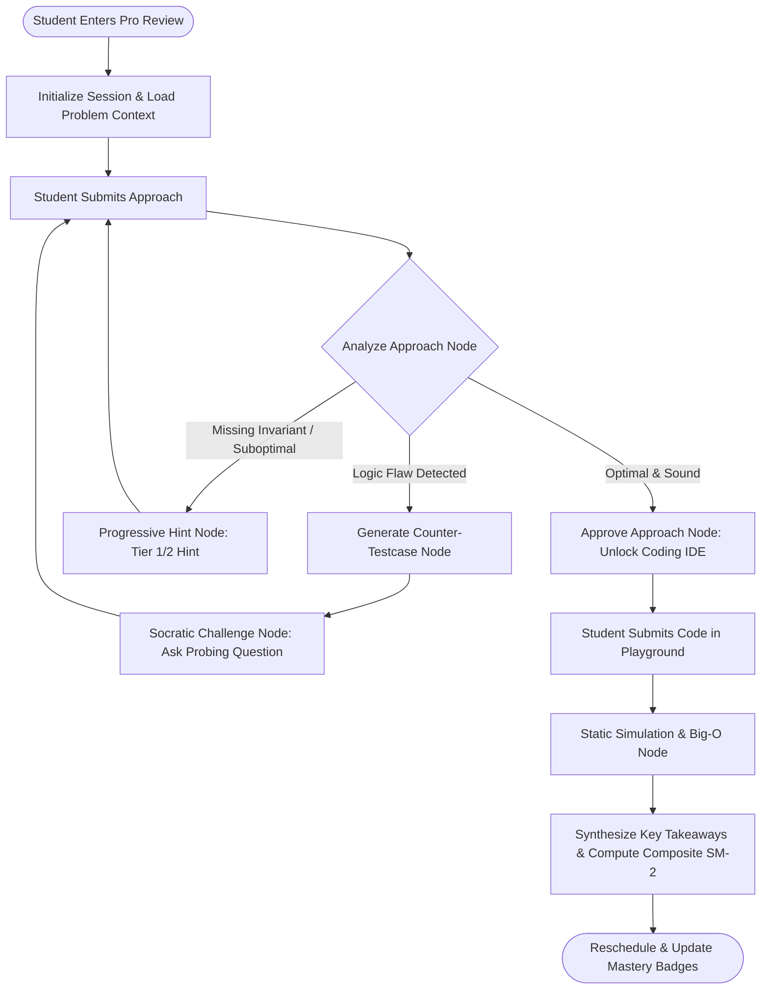

# Phase 2 Specification: Pro Tier Conversational Socratic Mock Interviewer

> **Status:** On Hold (Specification & Design Locked)  
> **Target Framework:** LangGraph (`@langchain/langgraph`) + LangChain (`@langchain/openrouter`) + LangSmith Tracing  
> **Purpose:** Transforms passive spaced repetition into an active, turn-by-turn conversational mock interview that challenges student logic with adversarial counter-examples before coding.

---

## 1. Architectural Vision

Traditional DSA practice gives away the answer too quickly or tests recall in a single-turn vacuum. The **Socratic Mock Interviewer** acts as a senior technical interviewer at a tier-1 company:
1. **Never gives away code immediately**: Guides via progressive hint scaffolding.
2. **Challenges naive or incomplete logic**: Constructs dynamic counter-examples and adversarial test cases on the fly.
3. **Validates invariants before implementation**: Prevents students from writing code until their algorithmic invariant is mathematically sound.
4. **Multi-turn stateful persistence**: Preserves interview context, hints used, and evaluation criteria across conversation turns.

---

## 2. LangGraph State Machine Architecture



---

## 3. LangGraph State Schema (`InterviewState`)

```typescript
import { BaseMessage } from "@langchain/core/messages";

export interface SocraticInterviewState {
  // Problem & Context
  questionId: string;
  title: string;
  optimalPatterns: string[];
  optimalComplexity: { time: string; space: string };
  originalNotes: string;
  referenceCode: string;

  // Dialogue & Memory
  messages: BaseMessage[];
  turnCount: number;
  maxTurns: number; // default: 6 turns to keep interview concise

  // Scaffolding & Evaluation Trackers
  hintsGiven: Array<{ tier: 1 | 2 | 3; content: string }>;
  counterTestCases: Array<{ input: string; expectedOutput: string; reason: string }>;
  isApproachApproved: boolean;

  // Code & Final Grading
  submittedCode?: string;
  codeLanguage?: string;
  conceptualScore?: number; // 0-5
  codeExecutionScore?: number; // 0-100
  compositeSM2Grade?: number; // 0-5
  keyTakeaways?: string[];
}
```

---

## 4. Key Nodes in the LangGraph Flow

### Node 1: `analyze_approach`
- **Role:** Compares student's proposed approach against optimal patterns and edge conditions.
- **Model:** `meta-llama/llama-3.3-70b-instruct` or `anthropic/claude-3.5-sonnet` with structured output via Zod.
- **Output:** `{ isSound: boolean, flawCategory?: 'complexity' | 'boundary' | 'wrong_ds' | 'incomplete_invariant', flawExplanation?: string }`.

### Node 2: `generate_counter_testcase`
- **Role:** Generates an adversarial minimal test case where the student's proposed logic fails.
- **Examples:**
  - *Student claims Two-Pointer works on unsorted array:* Counter-testcase: `[3, 1, 4], target = 5`.
  - *Student forgets negative weights in shortest path:* Counter-testcase with negative cycle or negative edge.
  - *Student uses monotonic stack without strict equality:* Duplicate element edge case `[2, 2, 2]`.

### Node 3: `socratic_dialogue`
- **Role:** Formulates a friendly, authentic interviewer question referencing the student's exact variable names:
  > *"I like your intuition about using a two-pointer approach! Before we write the code, how would your current loop condition handle this specific case: `nums = [-3, 1, 4], target = 1`?"*

### Node 4: `evaluate_code_implementation`
- **Role:** Performs mental execution of code against standard test cases and the adversarial counter-test cases synthesized in Node 2.

### Node 5: `synthesize_takeaways_and_grade`
- **Role:** Generates a post-interview feedback scorecard:
  - **Conceptual Independence:** Did they self-correct or need Level 3 hints?
  - **Invariant Mastery:** Did they formulate the core recurrence accurately?
  - **Code Robustness:** Did the code handle boundaries without off-by-one errors?
  - **SM-2 Quality Score ($q \in [0, 5]$)**: Factored into SuperMemo-2 interval scheduler.

---

## 5. Monetization & Tier Gating Strategy

1. **Free Tier:**
   - Multi-Stage 4-Step Review Stepper (Step 1 Approach $\rightarrow$ Step 2 AI Critique $\rightarrow$ Step 3 Code Playground $\rightarrow$ Step 4 SM-2 Rescheduling).
   - High utility, deterministic, low token cost per review (~1200 tokens).

2. **Pro / Paid Tier:**
   - Unlimited Conversational Socratic Mock Interviews.
   - Live Voice mode / Speech-to-Text natural dialogue.
   - Comprehensive Interview Readiness Scorecard & Weakness Heatmap.
   - Token budget per session: ~3500-5000 tokens managed via LangGraph checkpointing.

---

## 6. Implementation Prerequisites When Resuming
- Install `@langchain/langgraph` in `server/package.json`.
- Configure persistent memory saver (`MemorySaver` or MongoDB checkpointer).
- Wire WebSocket or Server-Sent Events (SSE) route: `POST /api/ai/socratic-interview/chat` for real-time streaming tokens.
- Add Pro Tier toggle badge on Question Cards: `[ ⚡ Switch to Socratic Mock Mode ]`.
